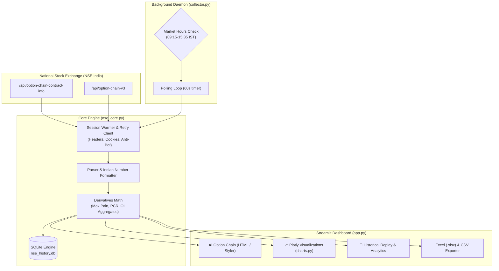

# 📊 NSE Option Chain Dashboard & Quantitative Analytics Suite

<p align="center">
  
  
  
  
  
</p>

A high-performance, real-time derivatives dashboard for the **National Stock Exchange of India (NSE)**. It extracts live option chain contracts, computes real-time quantitative metrics (such as vectorized **Max Pain** and **Put-Call Ratio**), generates interactive **Plotly** visualizations, and records intraday time-series data to **SQLite** for post-market analysis.

---

## 🌟 Key Features

### 1. 📊 Real-Time Option Chain Viewer
- **Multi-Asset Support:** Seamlessly inspect major Indian indices (**NIFTY, BANKNIFTY, FINNIFTY, MIDCPNIFTY, NIFTYNXT50**) and high-liquidity equities (e.g. `RELIANCE`, `TCS`, `HDFCBANK`).
- **High-Fidelity NSE Styling:** Mirrors the official `nseindia.com` table layout with:
  - **In-the-Money (ITM)** yellow shading (`#efe9cf`)
  - **At-the-Money (ATM)** highlight border (`#ffe066`)
  - Green/Red coloration for positive and negative price shifts
  - True **Indian numbering format** (e.g. `1,05,611` instead of standard Western thousands).
- **Custom View Mode:** Select arbitrary columns (OI, IV, Volume, LTP, Bid/Ask) and adjust strike ranges centered around the ATM strike.

### 2. 🧮 Quantitative Derivatives Analytics
- **Vectorized Max Pain Algorithm:** Identifies the strike price where option sellers encounter minimal loss (and buyers face maximum expiration loss) computed using optimized NumPy matrix broadcasting:
  $$\text{Buyer Payoff} = \sum (\text{CE\_OI} \times \max(0, k - s)) + \sum (\text{PE\_OI} \times \max(0, s - k))$$
- **Put-Call Ratio (PCR):** Real-time sentiment gauge computed over total Put Open Interest vs. Call Open Interest.
- **Spot Tracking:** Dynamic underlying price tracking with automatic strike centering.

### 3. 📈 Interactive Visualization Suite (Plotly)
- **Open Interest Distribution:** Side-by-side grouped bar chart comparing Call vs. Put OI across all strikes.
- **Change in Open Interest:** Identifies aggressive call writing or put unwinding intraday.
- **Traded Volume by Strike:** Pinpoints high-activity liquidity hubs.
- **Implied Volatility (IV Smile):** Plots volatility skew across strikes for pricing anomalies.
- **Option Premium Curve (LTP):** Strike-by-strike premium decay visualization.

### 4. 📜 Historical Intraday Persistence
- **Dual Logging System:**
  - **CSV Snapshots:** Automatically appends timestamped records into `history/<symbol>_<expiry>.csv`.
  - **Relational SQLite DB (`nse_history.db`):** Maintains indexed snapshots to replay Spot vs. PCR trends and strike-level price movements over time.
- **Headless Collector Daemon:** Run `collector.py` independently without launching a browser or UI.

### 5. 📱 Multi-Device Ready
- Bind the web server to `0.0.0.0` with a single click (`run_network.bat`) to access the full live dashboard from your smartphone, tablet, or secondary laptop on the same local network.

---

## 🏛️ System Architecture



---

## 🚀 Quick Start Guide

### Prerequisites
- Windows 10/11, macOS, or Linux
- Python **3.10+** (Python 3.13 recommended)

### 1. Installation
Clone the repository:
```bash
git clone https://github.com/RahulSamariya/NSE-Nifty-Option-Chain.git
cd NSE-Nifty-Option-Chain
```

Install all required dependencies:
```bash
pip install -r requirements.txt
```
*(On Windows, you can simply double-click `setup.bat`)*

### 2. Launching the Dashboard

#### Option A: Local Dashboard (Current PC)
```bash
streamlit run app.py
```
*(Or double-click `run.bat`)*  
Open your browser to: **`http://localhost:8501`**

#### Option B: Multi-Device Mode (Mobile / Wi-Fi)
```bash
streamlit run app.py --server.address 0.0.0.0
```
*(Or double-click `run_network.bat`)*  
Access via your phone/laptop on the same Wi-Fi: **`http://<YOUR-PC-IP>:8501`**

---

## 🤖 Running the Headless Data Collector

To continuously log option chain snapshots into SQLite during trading hours (09:15–15:35 IST) without keeping the web UI open:

```bash
# Log NIFTY every 60 seconds
python collector.py --symbol NIFTY --interval 60

# Log multiple symbols every 30 seconds
python collector.py --symbol NIFTY BANKNIFTY --interval 30

# Log outside market hours (testing mode)
python collector.py --symbol NIFTY --always
```
*(Or double-click `collect.bat`)*

---

## 📁 Repository Structure

```
├── app.py                # Main Streamlit web application & UI layer
├── nse_core.py           # Core library: session warming, parser, analytics, SQLite
├── charts.py             # Plotly figure generators (OI, Volume, IV Smile, Intraday)
├── collector.py          # Headless background polling daemon
├── requirements.txt      # Pinned Python package dependencies
├── config.json           # User-customized default settings (auto-generated)
├── push_to_github.bat    # 1-click helper script to push commits to GitHub
├── run.bat               # Windows launcher for local web dashboard
├── run_network.bat       # Windows launcher for Wi-Fi multi-device access
├── collect.bat           # Windows launcher for background data collector
├── setup.bat             # Automated environment setup script
└── history/              # CSV snapshot storage directory
```

---

## ⚙️ Configuration & Anti-Bot Protection

NSE enforces strict anti-scraping controls that block automated requests without proper session validation. This project overcomes this via:
- **Session Warming (`_warm`):** Pre-fetches the NSE homepage and option chain referer page to populate required session cookies (`bm_sv`, `nsit`, `ak_bmsc`).
- **Resilient Retry Loop:** Automatically triggers cookie refreshing and exponential backoff upon encountering HTTP 401/403 or network drops.
- **Config Persistence:** Adjust your default index, refresh frequency, and strike counts directly in the UI and click **"Save as default settings"** to persist your profile into `config.json`.

---

## ⚖️ Disclaimer & Notice

- This software is strictly for **educational and personal research purposes**.
- Derivatives trading carries significant financial risk. The metrics provided (such as Max Pain and PCR) are theoretical calculations and should not be considered investment advice.
- Respect the National Stock Exchange of India's (NSE) Terms of Service. Avoid setting polling intervals below 15–30 seconds to prevent unnecessary server load.

---

<p align="center">
  Developed by <b><a href="https://github.com/RahulSamariya">Rahul Samariya</a></b>
</p>
