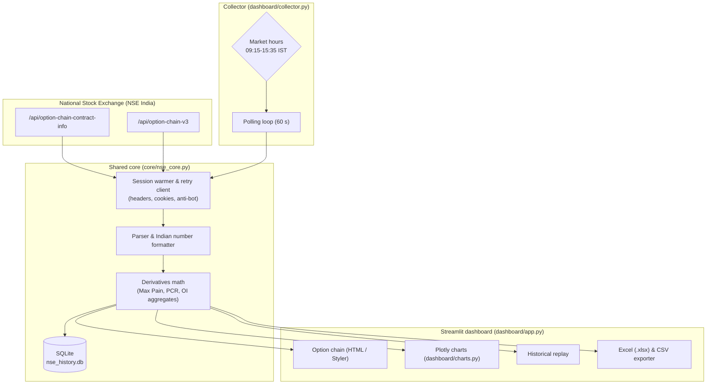

# 📊 Streamlit dashboard (`dashboard/`)

A local, real-time derivatives dashboard for the **National Stock Exchange of
India (NSE)**. It extracts live option chain contracts, computes quantitative
metrics (vectorized **Max Pain**, **Put-Call Ratio**), draws interactive
**Plotly** charts and records intraday snapshots to **SQLite**.

Everything here runs on your own machine. For the cloud version see
[`../web/`](../web); for the Excel feature see [`../excel/`](../excel).

---

## 🌟 Key features

### 1. 📊 Real-time option chain viewer
- **Multi-asset support:** major Indian indices (**NIFTY, BANKNIFTY, FINNIFTY,
  MIDCPNIFTY, NIFTYNXT50**) and high-liquidity equities (e.g. `RELIANCE`,
  `TCS`, `HDFCBANK`).
- **High-fidelity NSE styling:** mirrors the official `nseindia.com` layout with
  ITM shading, ATM highlight, green/red price changes and true **Indian numbering**
  (`1,05,611`, not `105,611`).
- **Custom view mode:** pick columns (OI, IV, Volume, LTP, Bid/Ask) and a strike
  range centred on the ATM strike.

### 2. 🧮 Quantitative derivatives analytics
- **Vectorized Max Pain:** the strike where option buyers lose the most, computed
  with NumPy matrix broadcasting.
- **Put-Call Ratio (PCR):** total Put OI vs Call OI.
- **Spot tracking** with automatic strike centring.

### 3. 📈 Interactive visualization suite (Plotly)
- Open interest by strike (Call vs Put)
- Change in open interest
- Traded volume by strike
- Implied volatility smile
- Option premium (LTP) curve
- Intraday spot / PCR replay

### 4. 📜 Historical persistence
- **CSV snapshots:** `history/<symbol>_<expiry>.csv`
- **SQLite:** `nse_history.db`, indexed snapshots for spot/PCR and strike-level
  replay
- **Headless collector:** `collector.py` logs without a browser or UI

### 5. 📱 Multi-device ready
Run `run_network.bat` to bind to `0.0.0.0` and use the dashboard from a phone,
tablet or laptop on the same Wi-Fi.

---

## 🏛️ How it fits together



---

## 🚀 Run it

Python **3.10+** (3.13 recommended).

```bash
# from the repository root
pip install -r requirements.txt          # or double-click setup.bat
```

| Mode | Command | Or double-click |
|---|---|---|
| Local dashboard | `streamlit run dashboard/app.py` | `dashboard/run.bat` |
| Phone / Wi-Fi | `streamlit run dashboard/app.py --server.address 0.0.0.0` | `dashboard/run_network.bat` |
| Headless collector | `python dashboard/collector.py --symbol NIFTY --interval 60` | `dashboard/collect.bat` |

Local dashboard: **`http://localhost:8501`**. Network mode:
**`http://<YOUR-PC-IP>:8501`**.

The launchers `cd` into `dashboard/` for you, so the paths above only matter when
you run Python by hand from the repository root. `config.json`, `history/` and
`nse_history.db` are always created at the repository root, whatever the working
directory.

---

## 🤖 Headless collector

Logs snapshots only on weekdays 09:15–15:35 IST unless you pass `--always`:

```bash
python dashboard/collector.py --symbol NIFTY --interval 60
python dashboard/collector.py --symbol NIFTY BANKNIFTY --interval 30
python dashboard/collector.py --symbol NIFTY --always      # testing
```

Stop with **Ctrl+C**.

---

## ⚙️ Configuration & anti-bot protection

NSE blocks plain automated requests. `core/nse_core.py` handles that with:

- **Session warming:** pre-fetches the NSE homepage and option chain referer to
  populate `bm_sv`, `nsit`, `ak_bmsc` cookies.
- **Resilient retry loop:** refreshes cookies and backs off on HTTP 401/403 or
  network errors.
- **Config persistence:** choose your default index, refresh interval and strike
  count in the UI, then click **"Save as default settings"** to store it in
  `config.json` at the repository root.

---

## 📁 Files in this folder

```
app.py            # Streamlit UI layer
charts.py         # Plotly figure builders
collector.py      # headless SQLite logger
run.bat           # local launcher
run_network.bat   # 0.0.0.0 launcher (phone / laptop on the same Wi-Fi)
collect.bat       # collector launcher
```

Shared code lives in [`../core/nse_core.py`](../core/nse_core.py); the SQLite
schema is in [`../db/schema.sql`](../db/schema.sql).

---

## ⚖️ Disclaimer

- Educational and personal research only.
- Derivatives trading carries significant risk; Max Pain and PCR are theoretical
  calculations, not investment advice.
- Respect NSE's Terms of Service. Avoid polling faster than 15–30 seconds.
